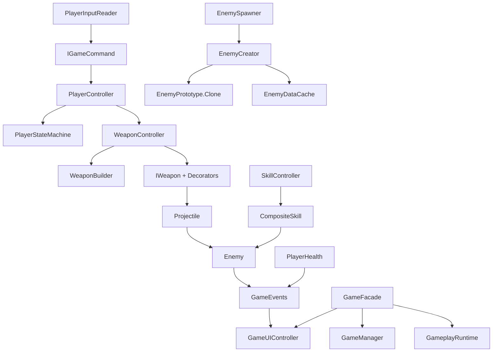
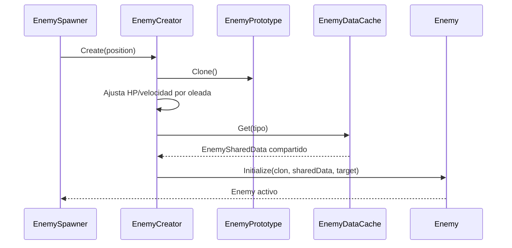
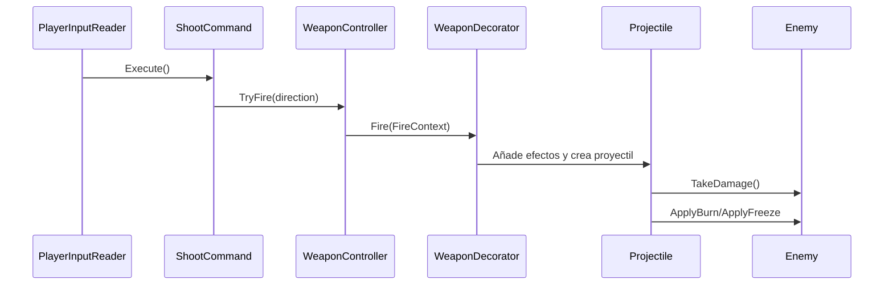
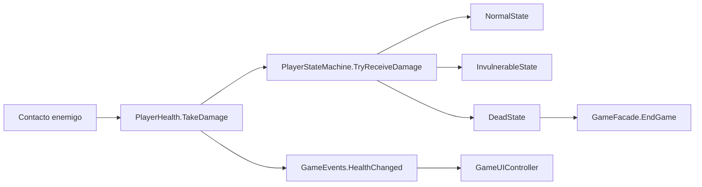

# Arquitectura

## Dependencias principales

## Generación de enemigos

`EnemyPrototype` es una configuración mutable por instancia: sus valores de HP, velocidad y contacto se ajustan para esa aparición. `EnemySharedData` contiene únicamente datos intrínsecos reutilizables y no guarda HP actual, posición ni timers.

## Disparo y daño

Builder configura la configuración inicial de `WeaponConfig`. Decorator envuelve un comportamiento `IWeapon` ya existente y añade efectos durante `Fire`; no son el mismo mecanismo.

## Daño al jugador

## Decisiones

- Se conserva la plantilla URP 2D existente porque el repositorio ya es un proyecto Unity compatible.
- Se mantiene el nuevo Input System activo. `PlayerInputReader` solo traduce dispositivos a comandos; los receptores siguen desacoplados.
- `GameManager` es el único Singleton. La caché de Flyweight no coordina la partida ni expone estado global de gameplay.
- `GameFacade` coordina ciclo de vida, pero las reglas de disparo, daño, experiencia y oleadas permanecen en sus subsistemas.
- El generador de editor crea una escena mínima estable. Gameplay, sprites geométricos y UI se construyen desde `GameplayRuntime` y `GameUIController`, evitando referencias serializadas frágiles y assets externos.
